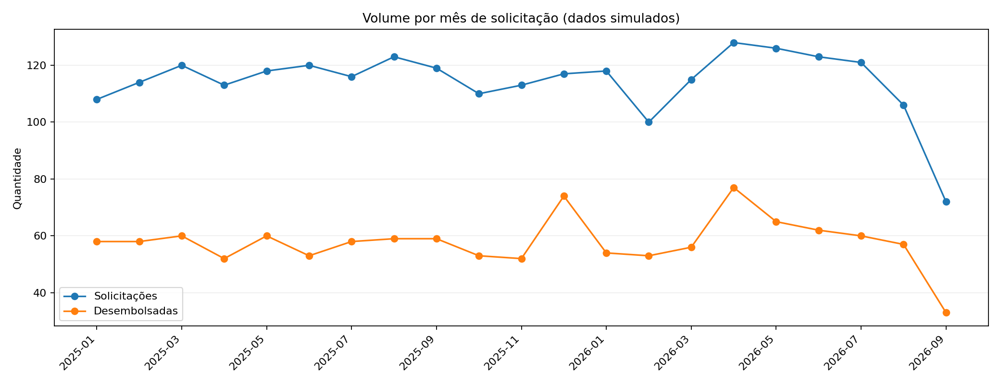
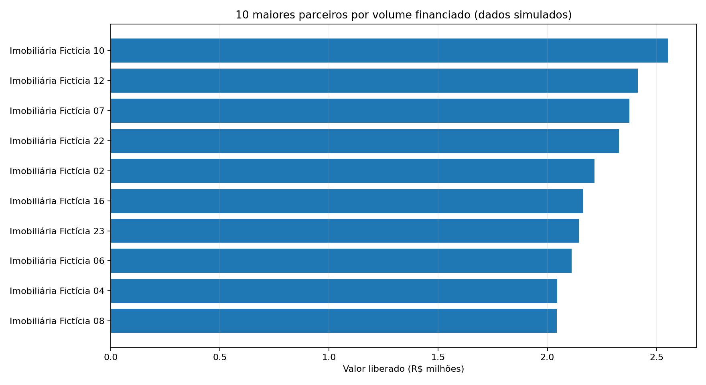
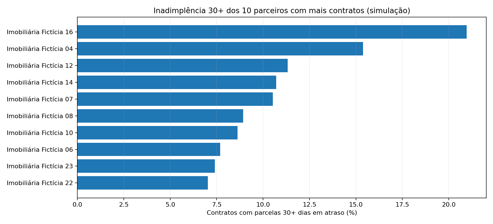

# Análise de Crédito e Performance Financeira

**Atlas Credit Lab — projeto de portfólio em Análise de Dados**

### [🚀 Acessar o dashboard interativo](https://c8lka6o86egxm5woxtgm8j.streamlit.app/)

[Explorar código-fonte](https://github.com/KleberJFIlho/analise-credito-performance-financeira) · [Dicionário de dados](docs/DICIONARIO_DE_DADOS.md) · [Guia do dashboard](docs/DASHBOARD_STREAMLIT.md)

Projeto educacional *end-to-end* que simula uma operação de crédito com imobiliárias parceiras. O objetivo é transformar dados relacionais em indicadores de negócio que apoiem a análise do funil de crédito, do risco de inadimplência e da eficiência operacional.

> **Transparência:** todos os dados, clientes, imobiliárias e resultados são **100% fictícios**, gerados para fins didáticos. Este projeto é independente, **não é oficial da CashGO** e não utiliza informações reais da empresa ou de instituições financeiras.

## Tecnologias e competências demonstradas

| Tecnologia | Aplicação prática |
| --- | --- |
| **Python** | Geração de dados sintéticos, processamento, validação e cálculos |
| **SQL** | JOINs, agregações, CTEs e consultas analíticas por parceiro, mês e risco |
| **SQLite** | Modelagem de cinco tabelas relacionais, chaves, integridade e índices |
| **Pandas** | Preparação de dados e cálculos com filtros |
| **Streamlit + Plotly** | Dashboard web com métricas, gráficos interativos, filtros e exportação CSV |
| **Matplotlib** | Gráficos estáticos para documentação e apresentação |
| **unittest + GitHub** | Testes de consistência, código versionado e projeto reproduzível |
| **Power BI** | **Roteiro de estudos e medidas DAX em documentação; painel .pbix ainda não desenvolvido** |

## Indicadores financeiros e interpretação

Exemplo de resultados da base simulada, **sem filtros**, com posição de inadimplência em **01/10/2026**:

| Indicador | Resultado simulado | Como interpretar |
| --- | ---: | --- |
| **Solicitações** | **2.400** | Total de pedidos de crédito recebidos |
| **Aprovação** | **60,25%** | Pedidos aprovados (inclusive os liberados) ÷ total de solicitações |
| **Créditos liberados** | **1.213** | Solicitações que geraram um contrato com crédito desembolsado |
| **Conversão** | **50,54%** | Créditos liberados ÷ solicitações |
| **Tempo médio de decisão** | **24,14 h** | Média de horas para análise e decisão do pedido |
| **Custo operacional médio** | **R$ 49,96** | Custo fictício médio por solicitação |

O painel também acompanha **inadimplência 30+** (contratos com ao menos uma parcela não paga há 30 dias ou mais, divididos pelos contratos liberados), **valor vencido 30+**, volume financeiro liberado, faixas de risco e comparativos por imobiliária parceira.

**Nota analítica:** a inadimplência é calculada em uma **data de referência fixa**, mesmo quando se filtram meses de solicitação; portanto, não é uma série histórica de inadimplência nem equivale à exposição total em risco. O volume mensal representa a **coorte de solicitação**, não o fluxo de caixa mensal.

## Perguntas de negócio

1. Quantas solicitações de crédito são recebidas e qual o percentual aprovado?
2. Qual parcela das solicitações vira crédito efetivamente liberado?
3. Quais imobiliárias parceiras geram mais volume, e quais têm maior inadimplência?
4. Quantos contratos possuem parcelas abertas com **30+ dias de atraso**?
5. Qual o tempo médio da decisão e o custo operacional por solicitação?
6. Como a revisão manual altera o SLA e o custo médio?

## Dashboard interativo

O repositório inclui um **dashboard em Streamlit publicado online**, acessível pelo [link do painel](https://c8lka6o86egxm5woxtgm8j.streamlit.app/). O painel abre no navegador, com filtros por mês, UF, parceiro, faixa de risco e status; gráficos de volume, funil, conversão, inadimplência e eficiência; tabelas e exportação CSV.

**Windows: entre na pasta e dê dois cliques em `INICIAR_DASHBOARD.bat`.** Na primeira execução é necessária conexão à internet para instalar bibliotecas que ainda não estejam presentes. Mantenha o terminal aberto para o servidor continuar funcionando.

Ou utilize o terminal na pasta do projeto:

```powershell
python -m pip install -r requirements.txt
python -m streamlit run app.py
```

Abra `http://localhost:8501` se o navegador não abrir sozinho. O comando `python run_pipeline.py` apenas regenera dados, consultas e imagens: **não abre a interface**.

Passo a passo completo: [Guia do dashboard Streamlit](docs/DASHBOARD_STREAMLIT.md).

## Prévia dos resultados simulados







Leia o [resumo executivo gerado](output/resumo_executivo.md). **Nenhum resultado representa métricas da CashGO.**

## Arquitetura

```text
Gerador Python (seed fixa)
        |
        v
5 CSVs em data/raw
        |
        v
SQLite (5 tabelas, PKs, FKs e índices)
        |
        v
Consultas SQL: KPIs, coortes mensais,
risco por contrato e comparação por parceiro
        |
        +--> CSVs de análise em output/
        +--> Gráficos PNG em imagens/
        +--> Interface Streamlit (app.py; filtros e gráficos)
        +--> Insumo para Power BI Desktop (passo manual)
```

## Como executar no Windows (PowerShell)

```powershell
# 1. Na pasta descompactada do projeto
py -m venv .venv

# 2. Ative o ambiente virtual
.\.venv\Scripts\Activate.ps1

# 3. Instale as dependências
python -m pip install -r requirements.txt

# 4. Execute a carga e a análise
python run_pipeline.py

# 5. Valide a integridade e os indicadores
python -m unittest discover -s tests -v
```

Se o Windows bloquear a ativação do PowerShell, use os comandos do executável diretamente (sem alterar políticas de execução):

```powershell
.\.venv\Scripts\python.exe -m pip install -r requirements.txt
.\.venv\Scripts\python.exe run_pipeline.py
.\.venv\Scripts\python.exe -m unittest discover -s tests -v
```

No Linux/macOS, use `python3 -m venv .venv`, `source .venv/bin/activate` e depois os mesmos comandos `python ...`.

## Arquivos principais

```text
analise-credito-performance-financeira/
├── run_pipeline.py             # Execução completa
├── requirements.txt            # pandas, matplotlib, streamlit, plotly
├── app.py                      # Painel web Streamlit
├── INICIAR_DASHBOARD.bat       # Atalho Windows (duplo clique)
├── .streamlit/config.toml      # Tema escuro
├── src/
│   ├── simulacao.py            # Dados fictícios e parcelas
│   ├── analise.py              # Carga SQLite + consultas
│   └── visualizacao.py         # Gráficos para portfólio
├── sql/
│   ├── schema.sql              # Modelo relacional e integridade
│   ├── kpis_gerais.sql
│   ├── volume_mensal.sql
│   ├── contratos_risco.sql
│   ├── desempenho_parceiros.sql
│   └── exemplos_avancados.sql # CTE, agregações, window function
├── data/
│   ├── raw/                    # Cinco CSVs sintéticos
│   └── credito_simulado.sqlite # Base SQLite já gerada
├── output/                     # Consultas exportadas e resumo
├── imagens/                    # Gráficos gerados por Python
├── docs/
│   ├── DICIONARIO_DE_DADOS.md
│   ├── POWER_BI_GUIA.md
│   └── DASHBOARD_STREAMLIT.md
└── tests/                     # Pipeline e dados do dashboard
```

## Exemplo SQL — volume e conversão por parceiro

```sql
SELECT p.nome_parceiro,
       COUNT(*) AS solicitacoes,
       SUM(CASE WHEN s.status='desembolsada' THEN 1 ELSE 0 END) AS desembolsadas,
       ROUND(100.0*SUM(CASE WHEN s.status='desembolsada' THEN 1 ELSE 0 END)
             / NULLIF(COUNT(*),0),2) AS conversao_pct
FROM solicitacoes s
JOIN parceiros p ON p.parceiro_id=s.parceiro_id
GROUP BY p.nome_parceiro
ORDER BY conversao_pct DESC;
```

Abra `data/credito_simulado.sqlite` em um cliente SQLite ou extensão SQLite do VS Code e rode as consultas de `sql/`.

## Modelagem e qualidade

- **Chaves primárias e estrangeiras** no banco para evitar registros órfãos.
- **Testes automatizados** de consistência: total de solicitações, desembolsos, pagamentos, integridade e reprodutibilidade.
- **Métrica 30+ com data de referência explícita**: parcela não paga com atraso ≥30 dias em 01/10/2026.
- **Limites claros**: os valores de contratos, custos, atrasos e taxas são inventados; o projeto não tenta inferir a performance de um negócio real.

Documentação: [dicionário e regras](docs/DICIONARIO_DE_DADOS.md) · [guia Power BI com DAX](docs/POWER_BI_GUIA.md).

## Evoluções sugeridas

- Construir o **Power BI Desktop real** e adicionar o `.pbix` e screenshots ao repositório.
- Elaborar análises mensais históricas de inadimplência usando múltiplas datas de corte.
- Adicionar testes de implantação e monitorar a disponibilidade da versão publicada no Streamlit Community Cloud.
- Implementar CI no GitHub Actions para executar os testes a cada `push`.

## Para recrutadores — o que este projeto demonstra

- **Tradução de perguntas de negócio em métricas:** aprovação, conversão, volume financeiro, inadimplência e SLA.
- **Conhecimento de SQL e bancos relacionais:** modelagem, integridade e consultas com agrupamentos e relacionamentos.
- **Capacidade de apresentar insights:** filtros, gráficos, tabelas e exportação de resultados pelo navegador.
- **Qualidade e comunicação:** testes automatizados, documentação das fórmulas e explicitação das limitações da simulação.

**Descrição sugerida para o currículo:** Projeto educacional de análise de crédito com Python, SQL, SQLite e Streamlit; modelagem de dados, consultas analíticas e dashboard interativo para acompanhamento de conversão, risco 30+, SLA e performance de parceiros. [Acessar painel](https://c8lka6o86egxm5woxtgm8j.streamlit.app/).

**Importante:** o projeto demonstra competências praticadas, mas **não representa experiência profissional com dados financeiros reais**. Não declare domínio de Power BI antes de construir e conseguir explicar um dashboard nessa ferramenta.

---

**Como apresentar no currículo (após estudar e executar):** “Projeto educacional de análise de crédito com Python, SQL e Streamlit: banco relacional SQLite, indicadores de conversão, inadimplência 30+, SLA, análise de parceiros e dashboard web interativo com filtros e exportação CSV.”

**Atenção:** apresentar uma prática guiada como projeto educacional é adequado; não a declare experiência profissional real, nem declare domínio de Power BI sem construí-lo e conseguir explicar o painel.
